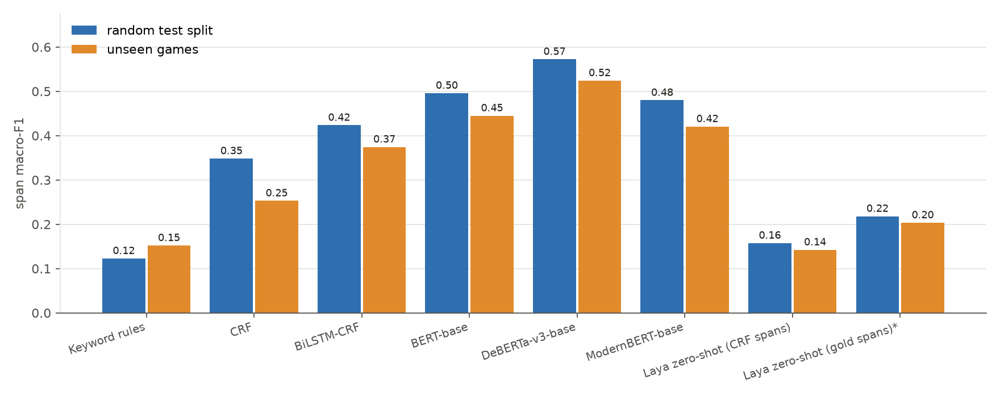

# What changed in this update? Patch-note change segmentation and typing

**COE025 Natural Language Processing, Project 2 (Token Classification)**
Team **Out of Vocabulary (OOV)**: İlyas Güney, Eren Taşkın, Nuri Tayfun Akbeniz

Given the plain text of a video game's patch notes, find **where every change starts and ends**
and **what type of change it is**, one BIO span per change item, 16 types:

```
Fixed a crash when loading saves . Reduced memory usage in Act 3 . Added Turkish subtitles . Rogue damage reduced by 10% .
B-FIX  I-FIX ...                   B-PERFORMANCE ...                B-LOCALIZATION ...          B-BALANCE ...
```

`FIX · KNOWN_ISSUE · NEW_CONTENT · IMPROVEMENT · BALANCE · GAMEPLAY · PERFORMANCE · UI · AUDIO · GRAPHICS ·
LOCALIZATION · MULTIPLAYER · CONTROLS · AI · MODDING · ACHIEVEMENT`

* **Dataset:** built by us from the public Steam News API. 477,597 announcements of the 5,000 most-owned
  Steam games → **39,481 examples, 532,761 change items, 7.7M tokens from 1,902 games**.
* **Labels:** the developers' own section headers (*Bug Fixes*, *Balance*, *Audio*, ...), mapped to 16 types
  and **removed from the input**, so the model has to recover both the boundaries and the types. No synthetic
  text, no LLM labels.
* **Metric:** strict span-level macro-F1 (seqeval, IOB2): a change counts only if its boundaries and its type
  are both right, and every type weighs the same (FIX is 83× more frequent than ACHIEVEMENT).
* **Methods:** 4 baselines from the course (keyword rules, CRF, BiLSTM-CRF, BERT-base) and 3 new methods
  (DeBERTa-v3, ModernBERT, and a two-stage CRF + Laya zero-shot method).
* **Two test sets:** a random split and **190 games the models never saw**.

## Results

Full report: **[results/benchmark.md](results/benchmark.md)** (generated by `src/benchmark.py`) and
**[results/error_analysis.md](results/error_analysis.md)**. Primary metric: strict span macro-F1 over 16 types.

| Model | Group | Test macro-F1 | Test boundary-F1 | Unseen-games macro-F1 |
|---|---|---|---|---|
| Keyword rules | baseline | 0.123 | 0.454 | 0.152 |
| CRF | baseline | 0.348 | 0.705 | 0.253 |
| BiLSTM-CRF (3 seeds) | baseline | 0.423 ± 0.006 | **0.810** | 0.374 ± 0.009 |
| BERT-base-cased | baseline | 0.496 | 0.605 | 0.445 |
| **DeBERTa-v3-base** | **new** | **0.572** | 0.731 | **0.524** |
| ModernBERT-base | new | 0.480 | 0.543 | 0.420 |
| CRF spans + Laya zero-shot | new | 0.158 | 0.720 | 0.142 |
| gold spans + Laya zero-shot* | new | 0.218 | 1.000 | 0.203 |

\* typing step only, with the gold boundaries given (upper bound); Laya rows use 500 sampled examples per split.



**Main findings**

1. **The task is far from saturated.** The best model reaches 0.57 span macro-F1 (token accuracy 0.72); even
   the most frequent type, FIX, stays at 0.81.
2. **The new encoder wins clearly.** DeBERTa-v3 beats the BERT baseline by 7.6 points on the random split and
   by 7.9 points on unseen games, although its word embeddings had to stay frozen on a 4 GB GPU.
3. **Encoders type best, the CRF layer segments best.** BiLSTM-CRF finds 81% of the change boundaries exactly,
   more than any encoder (DeBERTa 73%, BERT 60%), because the CRF scores whole tag sequences; the encoders tag
   every word on its own.
4. **Most errors are type errors caused by the headers.** Developers name sections by the *kind* of change
   (Bug fixes, New content) or by the *area* of the game (UI, Audio, Graphics), so "Fixed a bug that caused snow
   to flicker" can honestly be FIX or GRAPHICS. 12.7% of the test items start with a cue word of another type;
   UI, GAMEPLAY and GRAPHICS are most often predicted as FIX.
5. **New games cost about 5 points** for the neural models and 10 for the feature-based CRF.
6. **Zero-shot is not enough.** Laya, given only the 16 type definitions, reaches 0.22 even with the gold spans.

**Compute notes.** Everything ran on one laptop (16-thread CPU, RTX 3050 Ti 4 GB). The encoders were
fine-tuned on 20,000 of the 28,272 training examples for 3 epochs; their validation scores were still rising,
so they are under-trained. ModernBERT and DeBERTa used batch 2 × 4 gradient accumulation with gradient
checkpointing, and DeBERTa's 128k-word embedding matrix stayed frozen. The CRF was trained on 8,000 examples
(CPU time), BiLSTM-CRF on 15,000.

## Repository layout

```
.
├── configs/header_map.yaml        developer header -> change type rules (+ generic/promotional skip lists)
├── data/
│   ├── raw/patch_notes_raw_*.jsonl.gz      477,597 raw announcements as collected (4 shards < 100 MB)
│   └── processed/
│       ├── patch_notes_clean.jsonl.gz      cleaned, token-labelled examples (39,481)
│       ├── cleaning_report.json            size after every step + how the frequent headers were mapped
│       ├── train / val / test.jsonl.gz     random 80/10/10 split (grouped by announcement)
│       └── test_unseen_games.jsonl.gz      190 held-out games
├── src/
│   ├── collect.py              1. SteamSpy game list + Steam News API (cached, resumable)
│   ├── clean.py                2. sections, header mapping, items, cleaning, BIO, English, dedup, chunks
│   ├── split.py                3. random split + unseen-games split
│   ├── common.py               label set, type definitions, span extraction, one evaluation function
│   ├── train_classical.py      4a. keyword rules, CRF
│   ├── train_bilstm_crf.py     4b. BiLSTM-CRF from scratch (3 seeds)
│   ├── train_transformer.py    4c. BERT / DeBERTa-v3 / ModernBERT fine-tuning
│   ├── zero_shot_laya.py       4d. CRF spans + Laya zero-shot typing (and gold-span upper bound)
│   └── benchmark.py            5. results/benchmark.md and figures
├── results/                    one JSON per model, benchmark.md, figures/
├── docs/
│   ├── preprocessing.md        the data pipeline and every cleaning rule
│   ├── research.md             problem definition, label set, metric, methods, related work
│   └── results.md              analysis of the results and error analysis
├── contributions/              one file per team member
├── Makefile                    runs the whole pipeline
├── requirements.txt            pinned dependencies
└── LICENSE                     MIT for the code, data notice for the Steam announcements
```

## How to reproduce

```bash
python3.12 -m venv .venv && source .venv/bin/activate
pip install torch==2.14.1 --index-url https://download.pytorch.org/whl/cu130   # or the CPU build
pip install -r requirements.txt

make all          # or step by step:
make data         # collect (~1 h, needs internet) + clean (~3 min)
make splits       # train / val / test + unseen games
make classical    # keyword rules + CRF (~45 min on CPU)
make bilstm       # BiLSTM-CRF, 3 seeds (~50 min on GPU)
make transformers # BERT, DeBERTa-v3, ModernBERT (~35–60 min each on a 4 GB GPU)
make zeroshot     # Laya, needs models/crf.pkl from `make classical`
make benchmark    # writes results/benchmark.md and results/figures/
```

The raw data, the cleaned data and the splits are committed, so every model step can be run without
`make data`. All random steps use fixed seeds (42; BiLSTM-CRF 42/43/44). The numbers in `results/` were
produced on a laptop with a 16-thread CPU and an RTX 3050 Ti (4 GB): fp16 autocast, batch 4 with gradient
accumulation (ModernBERT: batch 2 × 4 with gradient checkpointing).

## Data

See **[docs/preprocessing.md](docs/preprocessing.md)** for the full pipeline. In short:

1. `collect.py` takes the 5,000 most-owned games from SteamSpy and downloads every developer announcement
   from the Steam News API (only the `steam_community_announcements` feed, full text).
2. `clean.py` splits each announcement at its section headers, maps every header to a type with
   `configs/header_map.yaml` (generic headers such as *General* or *Patch notes* and promotional ones such as
   *Prizes* are dropped), keeps only list items, removes BBCode/HTML/links, **removes the headers and the
   bullets from the input**, keeps English announcements with at least two types, removes duplicates and cuts
   long ones into chunks of at most 256 tokens at item boundaries.
3. `split.py` holds out 10% of the games completely and splits the rest 80/10/10 by announcement.

## Why span-level macro-F1

Token accuracy rewards a model that gets the long middle of an item right but its boundaries wrong, and
micro-F1 is dominated by FIX (31.5% of all items). Strict span-level macro-F1 counts a change only when its
first token, last token and type are all correct, and gives every type the same weight. We also report
**boundary-F1** (segmentation only, type ignored) to see whether a model fails at finding the changes or at
typing them. Details in [docs/research.md](docs/research.md); analysis in [docs/results.md](docs/results.md).

## License

Code: MIT. The announcements in `data/` belong to their developers and publishers and are shared for
non-commercial research and teaching only; see [LICENSE](LICENSE).
