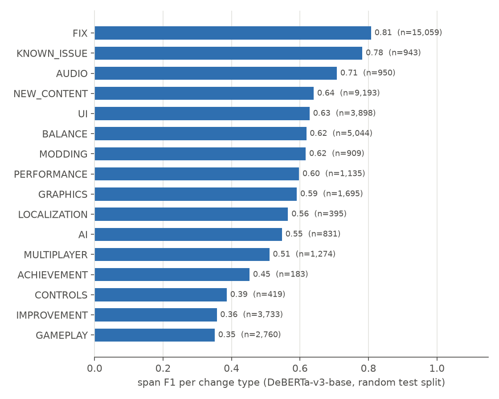
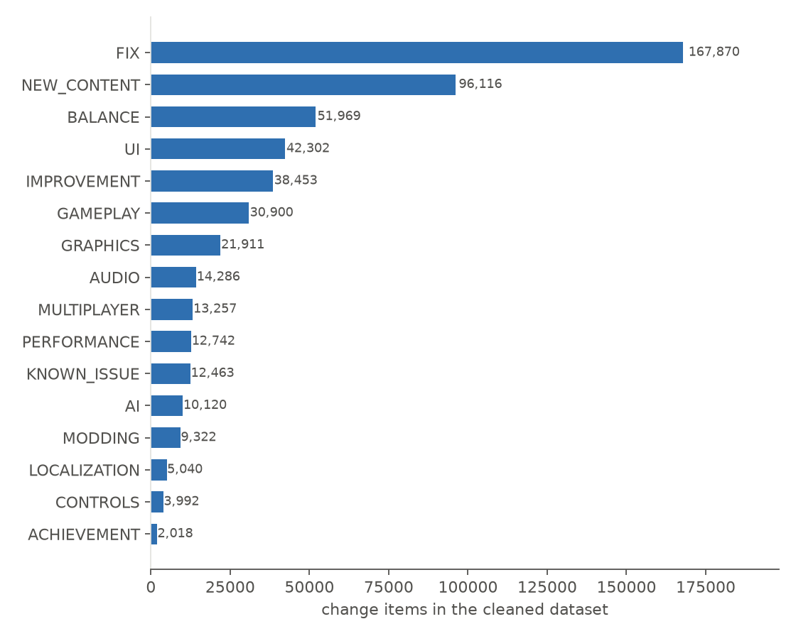

# Benchmark: patch-note change segmentation and typing

Generated by `src/benchmark.py`. Primary metric: **span-level macro-F1** (seqeval, strict IOB2) over 16 change types. A change counts as correct only if its boundaries and its type are both right.
`boundary-F1` ignores the type and only checks the segmentation.

## Data

| Step | Count |
|---|---|
| raw announcements | 477,597 |
| with section headers | 229,167 |
| two or more change types | 35,800 |
| english | 35,790 |
| after deduplication | 29,784 |
| examples (chunks) | 39,481 |
| change items | 532,761 |
| tokens | 7,677,885 |

| Split | Examples | Games | Tokens |
|---|---|---|---|
| train | 28,272 | 1,624 | 5,517,518 |
| val | 3,577 | 869 | 698,515 |
| test | 3,563 | 882 | 696,747 |
| test_unseen_games | 4,069 | 190 | 765,105 |

## Results

| Model | Group | Test macro-F1 | Test micro-F1 | Test boundary-F1 | Unseen-games macro-F1 | Unseen-games micro-F1 |
|---|---|---|---|---|---|---|
| Keyword rules | baseline | 0.123 | 0.200 | 0.454 | 0.152 | 0.211 |
| CRF | baseline | 0.348 | 0.444 | 0.705 | 0.253 | 0.367 |
| BiLSTM-CRF | baseline | 0.423 ± 0.006 | 0.524 ± 0.010 | 0.810 ± 0.004 | 0.374 ± 0.009 | 0.470 ± 0.012 |
| BERT-base | baseline | 0.496 | 0.580 | 0.605 | 0.445 | 0.524 |
| DeBERTa-v3-base | new | 0.572 | 0.646 | 0.731 | 0.524 | 0.590 |
| ModernBERT-base | new | 0.480 | 0.572 | 0.543 | 0.420 | 0.519 |
| Laya zero-shot (CRF spans) | new | 0.158 | 0.277 | 0.720 | 0.142 | 0.278 |
| Laya zero-shot (gold spans)* | new | 0.218 | 0.337 | 1.000 | 0.203 | 0.337 |

\* uses the gold change boundaries (an upper bound for the typing step only, not a fair competitor).
Laya rows are evaluated on a random sample of each test split (see the result file).

## Per-type scores of the best model on validation (DeBERTa-v3-base)

| Type | Items in data | Test F1 | Unseen-games F1 |
|---|---|---|---|
| FIX | 167,870 | 0.808 | 0.790 |
| NEW_CONTENT | 96,116 | 0.640 | 0.536 |
| BALANCE | 51,969 | 0.618 | 0.504 |
| UI | 42,302 | 0.628 | 0.583 |
| IMPROVEMENT | 38,453 | 0.357 | 0.227 |
| GAMEPLAY | 30,900 | 0.351 | 0.228 |
| GRAPHICS | 21,911 | 0.591 | 0.556 |
| AUDIO | 14,286 | 0.708 | 0.702 |
| MULTIPLAYER | 13,257 | 0.511 | 0.329 |
| PERFORMANCE | 12,742 | 0.597 | 0.429 |
| KNOWN_ISSUE | 12,463 | 0.782 | 0.823 |
| AI | 10,120 | 0.547 | 0.537 |
| MODDING | 9,322 | 0.617 | 0.516 |
| LOCALIZATION | 5,040 | 0.565 | 0.712 |
| CONTROLS | 3,992 | 0.386 | 0.414 |
| ACHIEVEMENT | 2,018 | 0.453 | 0.500 |

